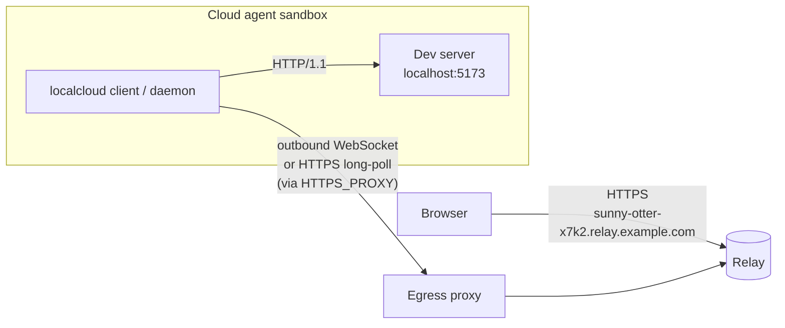
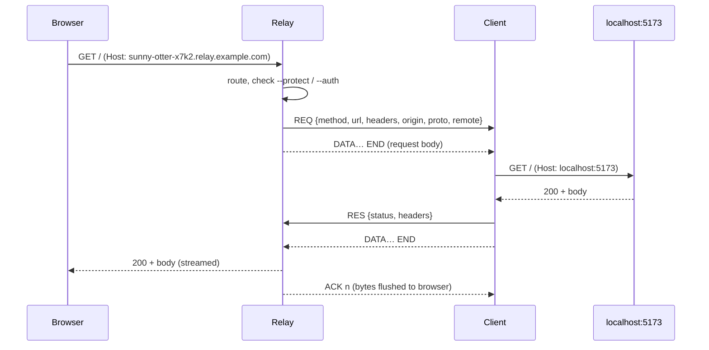

# How localcloud works

This document explains the moving parts: the client, the relay, the two transports, flow control,
header rewriting, reconnects, and the security model. For the exact bytes on the wire, see
[protocol.md](protocol.md).

- [The big picture](#the-big-picture)
- [Components](#components)
- [Connecting: getting out of the sandbox](#connecting-getting-out-of-the-sandbox)
- [Transports](#transports)
- [Tunnels, names and routing](#tunnels-names-and-routing)
- [Request lifecycle](#request-lifecycle)
- [Flow control](#flow-control)
- [Header rewriting](#header-rewriting)
- [WebSockets and HMR](#websockets-and-hmr)
- [Reconnects and stable URLs](#reconnects-and-stable-urls)
- [Waiting pages](#waiting-pages)
- [Background mode (the daemon)](#background-mode-the-daemon)
- [Port detection](#port-detection)
- [Security model](#security-model)

## The big picture

The sandbox never accepts an inbound connection. The client makes **one outbound connection** to
the relay and every tunnel and request is multiplexed over it. If `curl https://your-relay` works
from the sandbox, localcloud works too.

## Components

| Piece | Source | Role |
|---|---|---|
| CLI | `src/cli.js` | Parses commands and talks to the client or the daemon. |
| Client | `src/client/client.js` | One relay connection, any number of tunnels. Reconnects forever. |
| Transports | `src/client/transports.js`, `src/relay/server.js` | WebSocket and HTTPS long-poll, client and server sides. |
| Forwarder | `src/client/forward.js` | Replays tunneled requests against the local server and rewrites headers. |
| Network layer | `src/net.js` | Proxy (`CONNECT`) support, `NO_PROXY` matching, CA bundle discovery. |
| Flow control | `src/flow.js` | Per-stream credit window. |
| Protocol | `src/protocol.js` | Frame and batch encoding, hop-by-hop header filtering. |
| Daemon | `src/daemon.js` | Background process behind `start` / `ls` / `stop`, controlled over a Unix socket. |
| Port watcher | `src/watch.js` | Detects newly listening TCP ports. |
| Relay | `src/relay/server.js`, `src/relay/pages.js` | Public server: routing, access control, waiting pages. |
| MCP server | `src/mcp.js` | Stdio JSON-RPC wrapper over the daemon. |
| `init` | `src/init.js` | Writes agent instructions, the Claude Code hook and `.mcp.json`. |

## Connecting: getting out of the sandbox

Cloud agent sandboxes usually allow outbound traffic **only** through an HTTP proxy announced in
`HTTPS_PROXY`. Many of these proxies terminate and re-sign TLS with their own CA, and some refuse
WebSocket upgrades. `src/net.js` handles each of these:

- **Proxy discovery.** For `https:`/`wss:` targets the client uses the first non-empty value of
  `HTTPS_PROXY`, `https_proxy`, `ALL_PROXY` or `all_proxy`. For `http:`/`ws:` targets it uses
  `HTTP_PROXY`, `http_proxy`, `ALL_PROXY` or `all_proxy`. A proxy without a scheme is treated as
  `http://`.
- **`NO_PROXY` / `no_proxy`.** The client supports exact hosts, domain suffixes (`.example.com`,
  `*.example.com`, `example.com`), `host:port`, IPv4 CIDR ranges (`10.0.0.0/8`), bracketed IPv6,
  and `*`.
- **Tunneling.** The client sends an HTTP `CONNECT host:port` to the proxy (with
  `Proxy-Authorization: Basic …` if the proxy URL has credentials), then does TLS to the relay
  over the tunneled socket with ALPN `http/1.1`. The same agent is used for plain HTTPS requests
  and for the `ws` WebSocket client.
- **Custom CAs.** The client trusts Node's built-in roots **plus** every PEM bundle it finds in
  `NODE_EXTRA_CA_CERTS`, `SSL_CERT_FILE`, `REQUESTS_CA_BUNDLE`, `CURL_CA_BUNDLE`,
  `GIT_SSL_CAINFO`, and the usual system locations (`/etc/ssl/certs/ca-certificates.crt`,
  `/etc/pki/tls/certs/ca-bundle.crt`, `/etc/ssl/ca-bundle.pem`, `/etc/ssl/cert.pem`). A
  TLS-intercepting proxy whose CA is installed in the sandbox is therefore trusted with no extra
  configuration.
- **Clear errors.** A `403`/`407` from the proxy becomes `proxy refused CONNECT to host:443: HTTP 403
  (blocked by the network policy?)`, and the CLI adds a hint about allowlisting the relay domain.

## Transports

Both transports carry the same binary [frames](protocol.md#frames), so everything above the
transport layer is shared.

### WebSocket (fast path)

`GET /__localcloud/ws` is upgraded to a WebSocket. Each binary message is one frame. Per-message
deflate is off and the maximum message size is 64 MiB. The relay sends a WebSocket ping every 20 s
and drops the connection if a pong doesn't arrive before the next one.

### HTTPS long-polling (fallback)

The fallback is built for proxies that refuse upgrades or buffer streaming responses. It uses only
ordinary, short-lived `POST` requests:

- `POST /__localcloud/http/session` returns a session id.
- **Downstream (relay → client):** the client keeps exactly one `POST /http/down` open. The relay
  holds it for up to 15 s and answers as soon as it has frames to send, as a batch with a sequence
  number. The next poll acknowledges that sequence number. If a response is lost, the relay sends
  the same batch again.
- **Upstream (client → relay):** frames are batched into sequenced `POST /http/up` requests. A
  retried duplicate is accepted silently, and a gap closes the session.
- Batches are capped at about 4 MiB.

### Choosing a transport

With `--transport auto` (the default) the client tries the WebSocket with a 7 s timeout. If the
upgrade fails, or succeeds but no handshake reply arrives within 10 s (a proxy that "accepts" the
upgrade and then swallows frames), the client switches to long-polling. **That choice is sticky**
for the life of the process, so later reconnects go straight to long-polling. `--transport ws` and
`--transport http` force one transport. `localcloud doctor` tests both.

## Tunnels, names and routing

After the `HELLO`/`WELCOME` handshake, the client sends one `OPEN` per shared port. The relay
assigns an id and replies with the public URL.

- **Generated names** look like `sunny-otter-x7k2`: adjective + noun + four random characters,
  2^32 (about 4.3 billion) combinations, drawn with `crypto.randomInt`.
- **Custom names** (`--name`) are lowercased. Characters outside `[a-z0-9-]` become `-`, the name is
  trimmed to 48 characters, and reserved names (`www`, `api`, `app`, `admin`, `relay`, `mail`,
  `status`, `docs`, `dashboard`, `localcloud`, `_acme-challenge`) are rejected.
- **Ownership.** Every client process generates a random 24-byte secret and sends it with each
  `OPEN`. A name that is already registered can only be claimed again with the same secret.

A relay routes in one of two ways:

| Mode | When | Tunnel URL | How the relay finds the tunnel |
|---|---|---|---|
| `subdomain` | `--domain` / `LOCALCLOUD_DOMAIN` is set (default then) | `https://<id>.<domain>` | Host header label |
| `cookie` | no domain (default then) | `https://<relay>/__localcloud/t/<id>` | `__lc_t` cookie set by the `/t/<id>` entry URL |

Cookie routing needs no wildcard DNS or certificate, which is handy on a single free `*.fly.dev`
hostname. Its limits are that a browser can view **one tunnel per relay origin at a time**, and that
all tunnels share one origin (see the [security model](#security-model)). Visiting
`/__localcloud/exit` clears the routing cookie.

## Request lifecycle

1. The relay routes the request, checks access, and allocates a stream id.
2. It sends a `REQ` frame with the method, path, filtered headers, the visitor's IP, the public
   protocol and the public origin, followed by the request body as `DATA` frames and an `END`.
3. The client finds which loopback address answers on the port (`127.0.0.1`, then `::1`, cached),
   rewrites headers, and sends the request with Node's `http`/`https` modules. Bodies that the
   browser sent chunked are re-sent chunked, because the relay flags them in `REQ`. Local HTTPS targets
   are accepted without certificate verification.
4. The response comes back as `RES` + `DATA`… + `END` and is streamed to the browser without
   buffering (`x-accel-buffering: no`). Server-sent events and streaming responses work.
5. Either side can `ABORT` a stream, for example when the browser goes away or the local server
   resets. If headers haven't been sent yet, the relay shows an error page instead.

## Flow control

Without flow control, a fast local server could fill the relay's memory while a slow phone
downloads a large bundle, or the other way round. Every stream has an independent credit window in
**each direction** (`src/flow.js`):

- The sender may have up to **2 MiB** of unacknowledged `DATA` in flight. When it reaches the
  window it pauses its source stream (the local response, or the browser's request body).
- The receiver sends `ACK n` only after `n` bytes have been **flushed** to its destination socket.
  ACKs are coalesced once per event-loop turn.
- The sender resumes when in-flight data drops below half the window (1 MiB).

Backpressure from a slow browser therefore travels all the way back to the dev server, and memory
use stays bounded per stream regardless of transport.

## Header rewriting

Dev servers increasingly reject requests whose `Host` or `Origin` isn't `localhost`. Examples are
Vite's `server.allowedHosts`, webpack-dev-server's host check, Angular's dev server, and Next.js
dev-origin and Server Actions checks. Instead of asking you to edit configs, localcloud makes the
request look local. The default is `--host-header rewrite`.

**Relay, on the way in.** The relay drops the browser's `X-Forwarded-*`, `Forwarded`, `X-Real-IP`,
`Fly-*`, `CF-*` and `X-Localcloud-Probe` headers, and also `Authorization` when `--auth` is
in use. It strips its own `__lc_*` cookies and removes hop-by-hop headers, except
`Connection`/`Upgrade` on upgrades.

**Client, on the way to localhost:**

| Header | `rewrite` (default) | `preserve` | `<custom host>` |
|---|---|---|---|
| `Host` | `localhost:<port>` (or the target host) | public host | the custom value |
| `Origin` (if equal to the public origin) | local origin | unchanged | unchanged |
| `Referer` (if under the public origin) | local origin + path | unchanged | unchanged |
| `X-Forwarded-For` | visitor IP | visitor IP | visitor IP |
| `X-Forwarded-Proto` | `https` (public protocol) | same | same |
| `X-Forwarded-Host` | *not sent*, so same-origin checks pass | public host | public host |
| `X-Localcloud-Url` | public origin | same | same |

Your app can always read `X-Localcloud-Url` to build absolute public links.

**Client, on the way back:**

- `Location`, `Content-Location` and `Access-Control-Allow-Origin` values that point at the local
  origin (`localhost`, `127.0.0.1`, `[::1]` or `0.0.0.0` on the same port) are rewritten to the
  public origin, so redirects don't send visitors to `localhost`.
- `Domain=localhost` (and the other loopback variants) is removed from `Set-Cookie`, so cookies
  stick on the public host.

## WebSockets and HMR

An HTTP upgrade (WebSocket, Vite or webpack HMR, Next.js `/_next/webpack-hmr`, Socket.IO…) becomes
a raw, bidirectional byte stream. The client opens a TCP (or TLS) socket to the local server and
writes the rewritten request head itself. From then on, bytes are copied in both directions,
including the local server's `101 Switching Protocols` response, with the same flow control. Because
the stream rides on the tunnel, upgrades work over the long-poll transport too, at higher latency.

## Reconnects and stable URLs

Sandboxes nap, proxies drop idle connections, and laptops change Wi-Fi. The client handles each of
these:

- **Heartbeat.** The client sends `PING` every 15 s and treats 45 s of silence as a dead
  connection. The relay closes sessions that are silent for about 67 s, and long-poll sessions
  whose client stops polling for 45 s.
- **Clean shutdown.** On `stop`/Ctrl+C the client sends `CLOSE_TUNNEL` for each tunnel, flushes
  its queue, and closes the WebSocket with a close frame (or calls `/http/close` for long-polling),
  so the relay frees names at once.
- **Reconnect.** The client retries forever with exponential backoff (400 ms doubling, capped at
  about 10 s, with jitter). Only fatal handshake errors (a bad relay token, a protocol mismatch)
  stop it.
- **Same URL.** On reconnect the client re-sends `OPEN` for every tunnel with its **previous id**
  and the same process secret, so the relay hands back the same name. This holds even after a relay
  restart, as long as nobody else took the name in the meantime. If someone did, the client takes
  a fresh name and the foreground CLI prints `URL changed:`.
- **Reservations.** When a client disconnects without closing its tunnels, the relay keeps each
  tunnel's name reserved for **1 hour**. Requests that arrive while the tunnel is offline wait up
  to **8 s** for it to come back before getting the "reconnecting" page. `localcloud stop`, or
  Ctrl+C in the foreground, releases the name immediately.
- **Protected links** keep their access key across reconnects while the reservation lives. A relay
  restart generates a new key.

## Waiting pages

The relay serves small self-refreshing HTML pages (or `text/plain` for non-HTML requests) when it
can't hand a request to a local server:

| Situation | Status | Page |
|---|---|---|
| Nothing listening on the port yet / local server reset | 502 (504 on timeout) | "Nothing is answering on port N yet" (auto-reloads) |
| Tunnel exists but the client is reconnecting | 503 | "This tunnel is reconnecting" (auto-reloads) |
| Unknown tunnel | 404 | "No tunnel at this address" |
| `--protect` without a valid key | 401 | "This preview is private" |
| `--auth` without valid credentials | 401 | `WWW-Authenticate: Basic` challenge |

Auto-reloading pages poll the same URL with an `x-localcloud-probe: 1` header and reload once the
answer is anything other than 502/503/504.

## Background mode (the daemon)

Agents run commands in short-lived shells, so a foreground tunnel would die with the shell or block
the agent. `localcloud start` handles this:

1. It looks for a daemon on `~/.localcloud/daemon.sock` (a named pipe on Windows), mode `0600`.
2. If none is running, or the running one uses a different relay, token, transport or localcloud
   version, or it stopped after a fatal error, it starts a fresh detached `localcloud __daemon` with
   stdout/stderr going to `~/.localcloud/daemon.log`.
3. It sends `POST /share` over the socket, waits for the URL (up to 25 s), prints it and exits.

The daemon holds one `Client`, writes the current tunnels to `~/.localcloud/tunnels.json` and logs
connection events. `ls`, `url`, `stop`, `logs` and the MCP server all talk to it.
`LOCALCLOUD_HOME` relocates the whole directory.

## Port detection

`localcloud start` with no port, `--watch`, `localcloud run`, and the MCP `auto_share` tool use a
poller (`src/watch.js`) that checks the listening TCP sockets every second. It reads
`/proc/net/tcp` and `/proc/net/tcp6` on Linux and runs `lsof -iTCP -sTCP:LISTEN` on macOS. A port
is shared when:

- it is **1024 or higher**,
- it is bound to a wildcard or loopback address (`0.0.0.0`, `::`, `127.0.0.1`, `::1`). Sockets
  bound to one specific non-loopback IP are skipped,
- it isn't a well-known infrastructure port: 5432, 3306, 6379, 27017, 9229, 9222, 11211, 2375,
  2376 or 5037,
- it isn't listed in `LOCALCLOUD_IGNORE_PORTS`, and
- it **started listening after the watcher started**, or it was already listening and is a common
  dev port (1234, 3000–3003, 3333, 4000, 4173, 4200, 4321, 4322, 5000, 5001, 5173–5175, 5500, 6006,
  7000, 8000, 8001, 8008, 8080, 8081, 8888, 9000, 9292, 19006). This keeps agent infrastructure
  that was already running, such as the sandbox's own proxy, from being exposed.

`localcloud run` ignores ports that were already listening and shares any port that opens after
it starts. The watcher sees **every** process on the machine, not only the child process.

## Security model

In short:

- A plain tunnel URL is effectively **public**. Generated names are hard to guess, but anyone who
  has the link can use it.
- `--protect` adds a 144-bit access key that turns into an `HttpOnly` cookie. `--auth` adds HTTP
  basic auth that is checked at the relay and never forwarded to your app.
- The relay terminates TLS and can see all tunneled traffic, so run your own relay for
  confidentiality. `LOCALCLOUD_RELAY_TOKEN` restricts who can create tunnels.
- In cookie-routing mode every tunnel shares one browser origin. Use subdomain routing for relays
  shared by people who don't trust each other.

The full threat model, including guidance for public relay operators, is in [security.md](security.md).
